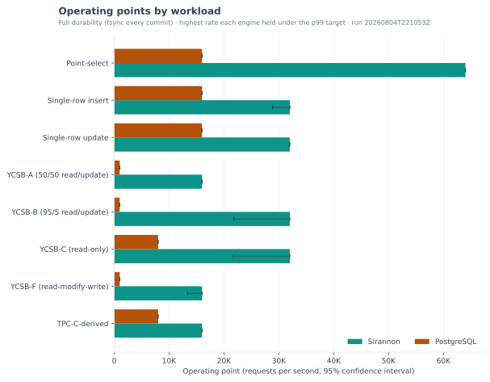
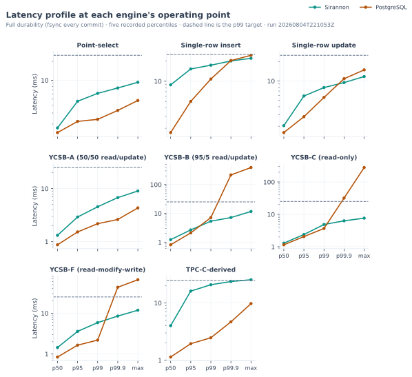
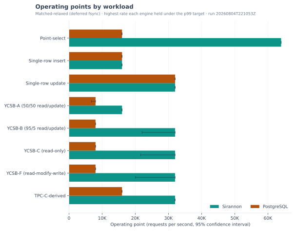
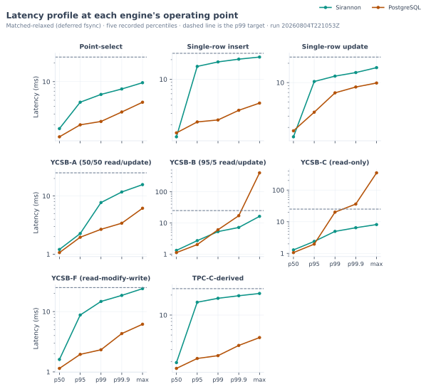
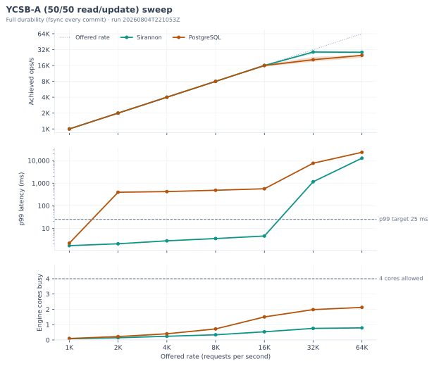
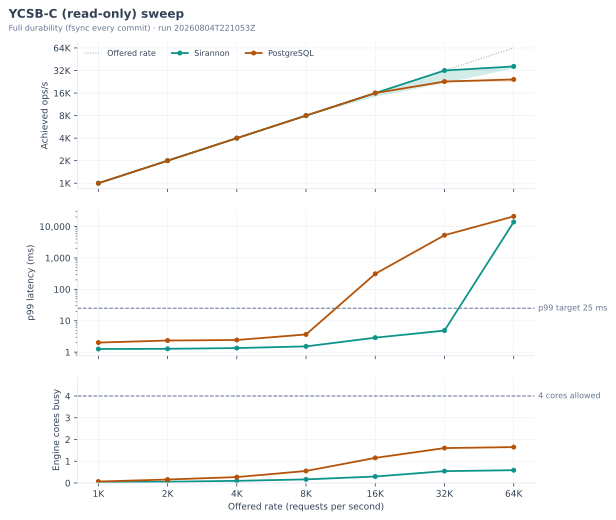
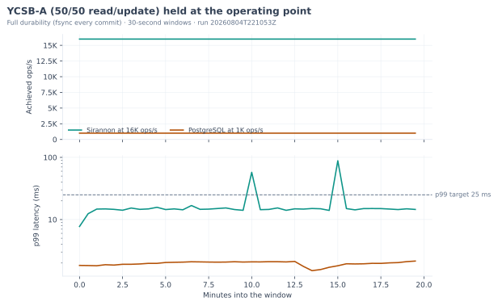
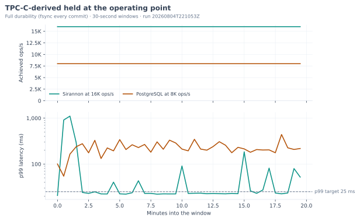
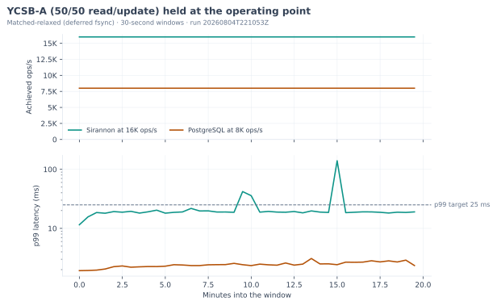
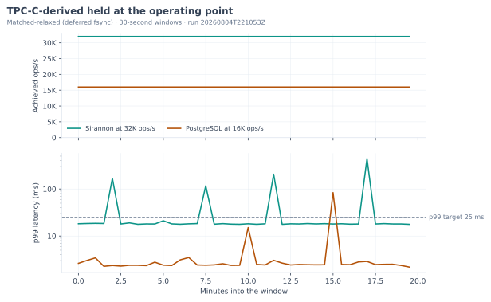

# Sirannon benchmarks

<!-- BENCH:intro START -->
The benchmark harness measures Sirannon and PostgreSQL 17 on the same OLTP workloads. For each workload, you can read the highest rate at which each engine held a latency target, the tail latency at that rate, and the rate at which the engine stopped keeping up.

Both engines operate at matched durability as native processes on one host, each pinned to its own logical CPUs under a hard memory ceiling. One open-loop load generator, which records the full tail latency, drives each engine through the client that the engine provides.
<!-- BENCH:intro END -->

The figures on this page come from the latest committed run under `benchmarks/server/results/runs/`. A generator in `benchmarks/writeup/` writes every table, and every paragraph that contains a figure, from the data that the harness recorded for that run, so the text and the numbers agree. When nobody has committed a run, the generator writes a placeholder in place of figures.

## Methodology

<!-- BENCH:methodology START -->
One Node load generator drives both databases through a small adapter for each one. Sirannon receives requests from its SDK over the SDK's default WebSocket transport, which sends every concurrent request over one persistent socket, while PostgreSQL receives them from node-postgres over the PostgreSQL wire protocol. Both engines answer on the same host over loopback. The figures include the cost of the JSON encoding that the Sirannon SDK applies to every call over the WebSocket, because that encoding is part of Sirannon's client path. Before each sweep, the generator measures each client's throughput ceiling against the live engine and records it with the results, so that you can see whether a client limited a rate.

The two engines handle concurrent requests in different ways. PostgreSQL serves each connection with [its own server process](https://www.postgresql.org/docs/17/tutorial-arch.html), which executes one request at a time. PostgreSQL can therefore work on as many requests at once as the pool has connections. While one WAL flush is in progress, PostgreSQL gathers the commits of the other connections that are waiting to flush and writes them all with the next flush, a mechanism that its documentation calls [group commit](https://www.postgresql.org/docs/17/wal-configuration.html). The Sirannon server executes reads one at a time on its main thread, which uses its 4 read connections in turn. For writes, its writer thread commits up to 1,000 queued writes in one transaction, so at full durability one fsync makes the whole group durable.

Both engines operate as native processes under Linux cgroup v2 control. The harness pins the engine under test to its own logical CPUs under a hard memory ceiling, while the load generator uses separate logical CPUs with no memory cap. The ceiling is smaller than the YCSB table, whose 10,000,000 rows each have ten 100-character fields. Before it seeds any data, the harness checks at the device level that each engine's data directory is on the machine's local NVMe. The harness measures the engines one after the other, starting a fresh engine process for each pass and stopping it afterwards, so neither engine keeps a warm buffer pool from one pass to the next. The harness also removes Sirannon's data directory after each Sirannon pass. Between passes, the harness syncs the disks, waits for dirty pages to drain, trims the data filesystem, and pauses for a fixed interval. Before each pass, it drops the operating system's page cache, so that neither engine starts with pages that the other engine cached.

The harness matches durability at two levels. At full durability, PostgreSQL uses `synchronous_commit=on` and Sirannon uses `synchronous=full`, so both engines fsync every commit. At matched-relaxed, PostgreSQL uses `synchronous_commit=off` and Sirannon uses `synchronous=normal` in WAL mode, so both engines defer the fsync. After a power loss, either engine can then lose its most recent commits, although neither database becomes corrupt.

The load is open-loop, which means that the generator schedules requests at a fixed target rate whether or not earlier requests have returned. When the in-flight limit is full, a scheduled request waits for a free slot. Its latency still counts from the time when the generator was meant to send it, which corrects for coordinated omission. An engine's operating point is the highest offered rate at which the engine sustained the load with the p99 of those latencies at or under the target.

Each measured window in the sweep is short, so on selected workloads the harness also holds each engine at its operating point for one long continuous window. That window is long enough to include checkpoints from both engines, so the 30-second slices that the page reports show whether an engine holds its operating point while it checkpoints.

Each engine starts from its defaults. The table below lists every other setting that the harness sets, except addresses and ports, with its default and the reason for its value.

| Engine | Setting | Value | Default | Reason |
| --- | --- | --- | --- | --- |
| PostgreSQL | `shared_buffers` | 512MB | 128MB | The value is 25% of the 2 GB memory ceiling, which the [PostgreSQL documentation](https://www.postgresql.org/docs/17/runtime-config-resource.html#GUC-SHARED-BUFFERS) gives as a starting value for a dedicated server. |
| PostgreSQL | `work_mem` | 64MB | 4MB | The harness raises the memory that PostgreSQL gives each sort and hash operation. Every statement in the benchmark is a key lookup or a single-row write, so none of them sorts or hashes. |
| PostgreSQL | `effective_cache_size` | 1536MB | 4GB | The value is 75% of the 2 GB memory ceiling. The [documentation](https://www.postgresql.org/docs/17/runtime-config-query.html#GUC-EFFECTIVE-CACHE-SIZE) states that the value should cover the shared buffers and the kernel cache for PostgreSQL data, but it gives no figure. |
| PostgreSQL | `maintenance_work_mem` | 256MB | 64MB | [Populating a Database](https://www.postgresql.org/docs/17/populate.html) recommends a larger value while you load large amounts of data. The harness keeps it for the whole pass. |
| PostgreSQL | `wal_level` | minimal | replica | [Populating a Database](https://www.postgresql.org/docs/17/populate.html) recommends it while you load large amounts of data. The harness keeps it for the whole pass, since neither engine replicates in this benchmark. |
| PostgreSQL | `max_wal_senders` | 0 | 10 | PostgreSQL [starts with `wal_level=minimal`](https://www.postgresql.org/docs/17/runtime-config-wal.html#GUC-WAL-LEVEL) only when this setting is 0. |
| PostgreSQL | `checkpoint_timeout` | 15min | 5min | The harness lengthens the interval so that PostgreSQL checkpoints less often. The [documentation](https://www.postgresql.org/docs/17/runtime-config-wal.html#GUC-CHECKPOINT-TIMEOUT) recommends no value, and it warns that a longer interval can lengthen crash recovery. |
| PostgreSQL | `max_wal_size` | 1GB | 1GB | The harness sets the default value explicitly. |
| PostgreSQL | `random_page_cost` | 1.1 | 4.0 | The harness lowers it for the NVMe disk, so that the planner treats a random read as costing about as much as a sequential one. The [documentation](https://www.postgresql.org/docs/17/runtime-config-query.html#GUC-RANDOM-PAGE-COST) suggests a lower value for data that is likely to be completely in cache. |
| PostgreSQL | `statement_timeout` | 60000 ms | 0, which turns it off | The PostgreSQL driver sets it to the load generator's request timeout. |
| Sirannon | `writerWorker` | on | off | The [server guide](https://github.com/assetcorp/sirannon-db/blob/main/docs/server.md#writer-worker) recommends it so that a disk flush leaves the serving thread free. |
| Sirannon | `writerWorker.writeTimeoutMs` | 0, which turns it off | 30000 ms | In an earlier benchmark, Sirannon reported the writer unresponsive 30 seconds into a `DROP TABLE` between workloads, because inside the 2 GB memory ceiling that drop can take more than a minute. |
| Sirannon | `maxBodyBytes` | 1 GiB | 1 MiB | The seed load sends 25,000 rows in each request, and a request of that size exceeds 1 MiB. |
| Sirannon | `readPoolSize` | 4 | 4 | The harness sets the default value explicitly. |
| Sirannon | `walMode` | true | true | The harness sets the default value explicitly. |
<!-- BENCH:methodology END -->

## The run

<!-- BENCH:setup START -->
- **Run.** [The run report](benchmarks/server/results/runs/20260804T221053Z/comparison.md) gives the full results of run `20260804T221053Z`, which the harness recorded on 2026-08-04. For the Sirannon full-durability, PostgreSQL full-durability, and Sirannon matched-relaxed passes, the harness recorded commit `25365d113607`, with uncommitted changes. For the PostgreSQL matched-relaxed pass, however, it recorded commit `650df41c6b3a`.
- **Machine.** The benchmark machine was GCP c3-standard-8-lssd, us-central1-b, where the harness recorded 8 logical CPUs (Intel(R) Xeon(R) Platinum 8481C CPU @ 2.70GHz), 31.3 GB of memory, and Linux 6.17.0-1021-gcp on x64.
- **Engines.** The harness measured Sirannon 0.2.2, whose storage engine is SQLite 3.53.4, and PostgreSQL 17.10 at full durability (fsync every commit) and at matched-relaxed (deferred fsync). Each engine operated as a native process under a 2G memory ceiling that cgroup v2 enforces, pinned to logical CPUs 4-7, while the load generator had logical CPUs 0-3 to itself.
- **Delivery.** One Node load generator on the same host sent every request over loopback, through the client that each engine provides. The Sirannon SDK sent its requests to Sirannon over one WebSocket, while node-postgres sent its requests to PostgreSQL over a pool of 16 connections, against a node-postgres default of 10. With either client, the generator kept at most 256 requests in flight at once.
- **Load-client headroom.** When the harness measured each client alone against its live engine, the Sirannon SDK sustained 110.3K requests a second and node-postgres sustained 41.3K, which are 1.72x and 0.64x the fastest offered rate. Each client's ceiling is above every operating point that its engine reached, so neither client limited a reported operating point. Since node-postgres sustained less than the fastest offered rate, the PostgreSQL figures at rates above 41.3K a second show the limit of node-postgres.
- **Workloads.** Of the 8 workloads, 7 start from a table that the harness seeds with 10,000,000 rows. For the Single-row insert workload, the table starts empty, so every row in it comes from the inserts that the generator sends during the sweep, with keys between 1 and 10,000,000. The harness offers target rates of 1,000, 2,000, 4,000, 8,000, 16,000, 32,000, and 64,000 requests a second. It raises each engine's rate along that list until the engine fails to sustain one. After that failure, it measures one more rate and stops, so the two sweeps can end at different rates. Each measurement has a 3 s warmup and a 10 s window under seed `42`. The harness measures every rate 5 independent times, so each figure is the median of those 5 repetitions with a 95% confidence interval. The service-level target for an operating point is a p99 of at most 25 ms.
- **Soak.** After the sweep, the harness held each engine at its operating point on YCSB-A (50/50 read/update) and TPC-C-derived for one continuous 20-minute window, which the page reports in 30-second slices.
- **Timeouts.** Sirannon's writer deadline was off, although its default is 30 seconds. The PostgreSQL driver set `statement_timeout` to the load generator's request timeout of 60,000 ms, which PostgreSQL reported as `1min`, while the PostgreSQL default of 0 turns that timeout off. No request failed at any rate in either engine's sweep, so neither limit ended a request. The Sirannon driver gave each schema reset between workloads a 30-minute request limit.
<!-- BENCH:setup END -->

## Operating points

An engine's operating point is the highest offered request rate at which the engine held its p99 latency at or under the disclosed target. Where an engine delivered a higher rate with a p99 above the target, its operating point is the lower rate that it last held, so an operating point can be well below the highest rate that the engine served. Each value in the ratio column is one operating point divided by the other, which means that a difference in tail latency can appear as a difference in rate. The sweep figures and tables further down give every rate that the harness offered to each engine, including the rates above its operating point.

<!-- BENCH:comparison START -->
### Full durability (fsync every commit)

| Workload | Sirannon ops/s | Sirannon 95% CI | Sirannon CV | Sirannon p99 ms | Sirannon missed at | Postgres ops/s | Postgres p99 ms | Postgres missed at | Rate ratio |
| --- | ---: | ---: | ---: | ---: | ---: | ---: | ---: | ---: | ---: |
| Point-select | **64.0K** | [64.0K, 64.0K] | 0.0% | 6.177 | held every rate | 16.0K | 2.378 | 32.0K (1,307 ms) | 4.00x [4.00x, 4.00x] |
| Single-row insert | **32.0K** | [28.8K, 32.0K] | 4.5% | 17.331 | 64.0K (10,063 ms) | 16.0K | 10.770 | 32.0K (3,447 ms) | 1.96x [1.88x, 2.00x] |
| Single-row update | **32.0K** | [32.0K, 32.0K] | 0.0% | 7.928 | 64.0K (886 ms) | 16.0K | 5.574 | 32.0K (3,291 ms) | 2.00x [2.00x, 2.00x] |
| YCSB-A (50/50 read/update) | **16.0K** | [16.0K, 16.0K] | 0.0% | 4.551 | 32.0K (1,157 ms) | 1.0K | 2.184 | 2.0K (396 ms) | 16.00x [16.00x, 16.00x] |
| YCSB-B (95/5 read/update) | **32.0K** | [21.8K, 32.0K] | 15.3% | 5.336 | 64.0K (15,156 ms) | 1000 | 7.119 | 2.0K (266 ms) | 29.96x [25.87x, 32.00x] |
| YCSB-C (read-only) | **32.0K** | [21.7K, 32.0K] | 15.5% | 4.865 | 64.0K (13,988 ms) | 8.0K | 3.664 | 16.0K (312 ms) | 3.74x [3.22x, 4.00x] |
| YCSB-F (read-modify-write) | **16.0K** | [13.4K, 16.0K] | 7.6% | 5.881 | 32.0K (6,457 ms) | 1.0K | 2.196 | 2.0K (377 ms) | 15.47x [14.42x, 16.00x] |
| TPC-C-derived | **16.0K** | [16.0K, 16.0K] | 0.1% | 20.912 | 32.0K (6,647 ms) | 8.0K | 2.466 | 16.0K (104 ms) | 2.00x [2.00x, 2.00x] |

### Matched-relaxed (deferred fsync)

| Workload | Sirannon ops/s | Sirannon 95% CI | Sirannon CV | Sirannon p99 ms | Sirannon missed at | Postgres ops/s | Postgres p99 ms | Postgres missed at | Rate ratio |
| --- | ---: | ---: | ---: | ---: | ---: | ---: | ---: | ---: | ---: |
| Point-select | **64.0K** | [64.0K, 64.0K] | 0.0% | 6.208 | held every rate | 16.0K | 2.266 | 32.0K (1,052 ms) | 4.00x [4.00x, 4.00x] |
| Single-row insert | 16.0K | [16.0K, 16.0K] | 0.1% | 18.458 | 32.0K (27.644 ms) | 16.0K | 2.381 | 32.0K (192 ms) | 1.00x [1.00x, 1.00x] |
| Single-row update | 32.0K | [32.0K, 32.0K] | 0.1% | 12.613 | 64.0K (69.318 ms) | 32.0K | 6.917 | 64.0K (10,979 ms) | 1.00x [1.00x, 1.00x] |
| YCSB-A (50/50 read/update) | **16.0K** | [16.0K, 16.0K] | 0.0% | 7.718 | 32.0K (1,296 ms) | 8.0K | 2.675 | 16.0K (199 ms) | 2.06x [2.00x, 2.20x] |
| YCSB-B (95/5 read/update) | **32.0K** | [22.0K, 32.0K] | 14.8% | 5.283 | 64.0K (15,115 ms) | 8.0K | 6.054 | 16.0K (179 ms) | 3.75x [3.25x, 4.00x] |
| YCSB-C (read-only) | **32.0K** | [21.6K, 32.0K] | 15.5% | 4.948 | 64.0K (13,523 ms) | 8.0K | 20.059 | 16.0K (291 ms) | 3.74x [3.22x, 4.00x] |
| YCSB-F (read-modify-write) | **32.0K** | [20.1K, 32.0K] | 18.0% | 14.719 | 64.0K (13,707 ms) | 8.0K | 2.326 | 16.0K (224 ms) | 3.70x [3.10x, 4.00x] |
| TPC-C-derived | **32.0K** | [32.0K, 32.0K] | 0.1% | 17.878 | 64.0K (3,622 ms) | 16.0K | 2.443 | 32.0K (298 ms) | 2.00x [2.00x, 2.00x] |

_Bold marks the higher of the two operating points on each workload. Where both engines held the target at the same rate, neither cell is bold. Each p99 comes from its own engine's operating point, so the two p99 columns can describe different offered rates. For both engines at one offered rate, use the sweep tables below. Each 'missed at' column gives the next offered rate above the operating point at which that engine missed the target, with its p99 at that rate._

_Each throughput figure is the median of the repeated measurements at the operating point, which is the highest offered rate that the engine held at or under the p99 target. The table shows each Sirannon figure with a 95% bootstrap confidence interval and the coefficient of variation across repetitions. The rate ratio is Sirannon's operating point divided by PostgreSQL's, so a ratio above one means that Sirannon held the target at a higher rate. Every ratio is approximate, because the harness doubles the offered rate at each step, so an engine's highest sustainable rate lies between its operating point and the rate in its 'missed at' column. For TPC-C-derived, the generator sends two kinds of one-statement write in equal shares, which are an insert into `orders` and an update of one customer's balance. Neither write is a full TPC-C transaction. The harness measures YCSB A, B, C, and F, but not D or E._
<!-- BENCH:comparison END -->

## Throughput versus offered load

Each figure below plots achieved throughput, p99 latency, and busy engine cores against the offered rate, while the table under it gives the same rates as numbers. The middle panel shows the rate at which each engine's tail latency rises past the target.

<!-- BENCH:scaling START -->
Each figure and table below shows one workload at full durability (fsync every commit), at every offered rate in the sweep. PostgreSQL locks individual rows, while Sirannon commits every write through a single writer, so which engine keeps up as the rate rises depends on the workload. The dotted line on the top panel marks the offered rate, so the point where an engine's curve falls below that line is the rate at which the engine stopped keeping up.

_Each row gives both engines at the same offered rate, so bold marks the better of the two figures, which is the higher achieved throughput and the lower p99. Where the two figures are equal, neither is bold._

### YCSB-A (50/50 read/update)

| Target ops/s | Sirannon ops/s | Sirannon p99 ms | Postgres ops/s | Postgres p99 ms |
| ---: | ---: | ---: | ---: | ---: |
| 1,000 | 1.0K | **1.703** | 1.0K | 2.184 |
| 2,000 | 2.0K | **2.062** | 2.0K | 396 |
| 4,000 | 4.0K | **2.784** | 4.0K | 423 |
| 8,000 | 8.0K | **3.517** | 8.0K | 485 |
| 16,000 | 16.0K | **4.551** | 16.0K | 565 |
| 32,000 | **28.8K** | **1,157** | 20.6K | 7,666 |
| 64,000 | **28.5K** | **12,813** | 24.9K | 23,355 |

### YCSB-C (read-only)

| Target ops/s | Sirannon ops/s | Sirannon p99 ms | Postgres ops/s | Postgres p99 ms |
| ---: | ---: | ---: | ---: | ---: |
| 1,000 | 1.0K | **1.259** | 1.0K | 2.019 |
| 2,000 | 2.0K | **1.279** | 2.0K | 2.344 |
| 4,000 | 4.0K | **1.348** | 4.0K | 2.439 |
| 8,000 | 8.0K | **1.527** | 8.0K | 3.664 |
| 16,000 | 16.0K | **2.890** | 16.0K | 312 |
| 32,000 | **32.0K** | **4.865** | 22.8K | 5,290 |
| 64,000 | **36.3K** | **13,988** | 24.3K | 21,041 |

_The directory `benchmarks/server/results/runs/20260804T221053Z/charts/` contains the same three-panel figure for every workload at both durability levels._
<!-- BENCH:scaling END -->

## Holding the operating point

The tables in this section show whether each engine kept its operating point through its periodic checkpoints.

<!-- BENCH:soak START -->
Each sweep window is short, so for this section the harness held each engine at its operating point for one long continuous window. That window is long enough to include checkpoints from both engines, so the 'Worst 30 s p99' column, which gives the slowest 30-second slice, shows any stall that a checkpoint causes. Each figure plots every 30-second slice in order, so a periodic stall appears as a spike and a steady slowdown appears as a raised floor. An engine holds its operating point when it keeps at least 95% of the rate across the whole window, with under 1% errors and a p99 at or under the service-level target. An engine that keeps the rate with a p99 above the target therefore counts as a miss. Bold marks the higher achieved rate of the two engines on each workload. Where one engine held and the other missed, bold also marks the engine that held. Since each engine served its own operating point during the window, neither latency column is bold.

### Full durability (fsync every commit)

| Workload | Engine | Rate held | Achieved | p99 ms | Worst 30 s p99 | Errors | Held |
| --- | --- | ---: | ---: | ---: | ---: | ---: | --- |
| YCSB-A (50/50 read/update) | Sirannon | 16,000 | **16.0K** | 14.876 | 88.210 | 0.0% | yes |
| YCSB-A (50/50 read/update) | PostgreSQL | 1,000 | 1000 | 1.977 | 2.149 | 0.0% | yes |
| TPC-C-derived | Sirannon | 16,000 | **16.0K** | 867 | 1,107 | 0.0% | no |
| TPC-C-derived | PostgreSQL | 8,000 | 8.0K | 237 | 440 | 0.0% | no |

### Matched-relaxed (deferred fsync)

| Workload | Engine | Rate held | Achieved | p99 ms | Worst 30 s p99 | Errors | Held |
| --- | --- | ---: | ---: | ---: | ---: | ---: | --- |
| YCSB-A (50/50 read/update) | Sirannon | 16,000 | **16.0K** | 19.263 | 140 | 0.0% | yes |
| YCSB-A (50/50 read/update) | PostgreSQL | 8,000 | 8.0K | 2.428 | 3.090 | 0.0% | yes |
| TPC-C-derived | Sirannon | 32,000 | **32.0K** | 18.587 | 442 | 0.0% | yes |
| TPC-C-derived | PostgreSQL | 16,000 | 16.0K | 2.550 | 83.647 | 0.0% | yes |
<!-- BENCH:soak END -->

## Cold start and change-feed latency

This section gives the cold start of both engines and the change-feed latency of Sirannon, which the harness measures for Sirannon alone.

<!-- BENCH:features START -->
### Cold start

Cold start is the time from the command that starts the engine process to the first successful health probe, which the harness measures in the same way for both engines. Bold marks the faster start.

| Engine | Cold start ms |
| --- | ---: |
| Sirannon | 197 |
| PostgreSQL | **175** |

### Change-feed latency (Sirannon only)

This table gives the delay between the client sending a write and a subscriber receiving the change over Sirannon's built-in WebSocket feed. The server polls the change log every 50 ms. The harness sends each probe write as soon as the subscriber receives the previous change, so each write commits shortly after a poll and its change waits close to one full interval for the next poll. The harness measures no PostgreSQL equivalent, so the table gives Sirannon's figures alone.

| Samples | p50 ms | p95 ms | p99 ms | max ms |
| ---: | ---: | ---: | ---: | ---: |
| 200 | 50.998 | 51.157 | 51.226 | 51.770 |
<!-- BENCH:features END -->

## Reproducing this

The harness is in `benchmarks/server/`, whose README describes the method and explains how to start the suite on the benchmark VM or against a server that you start by hand. Use `benchmarks/cloud/` to execute the suite on the disclosed cloud machine before you publish figures.
