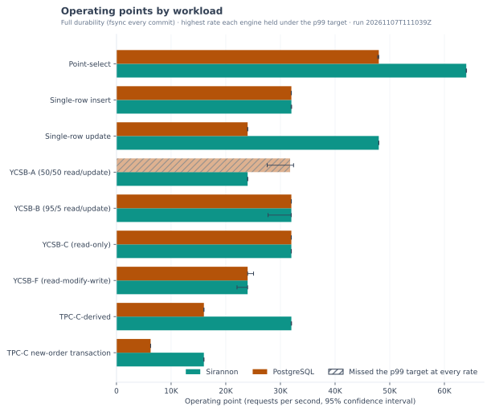
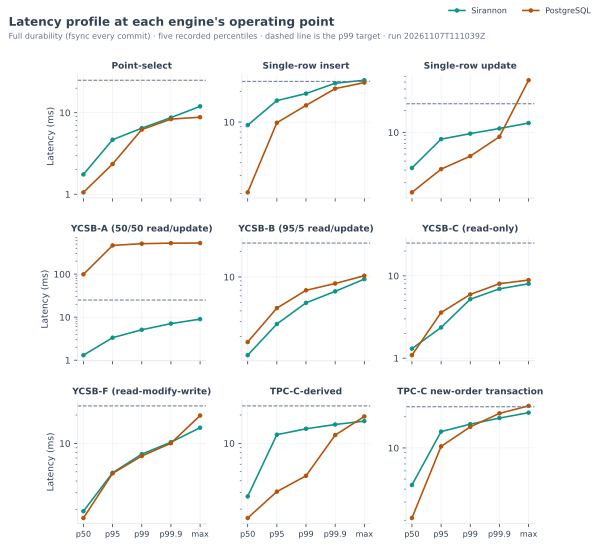
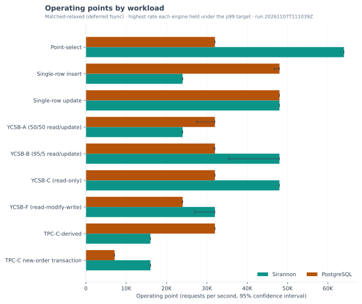
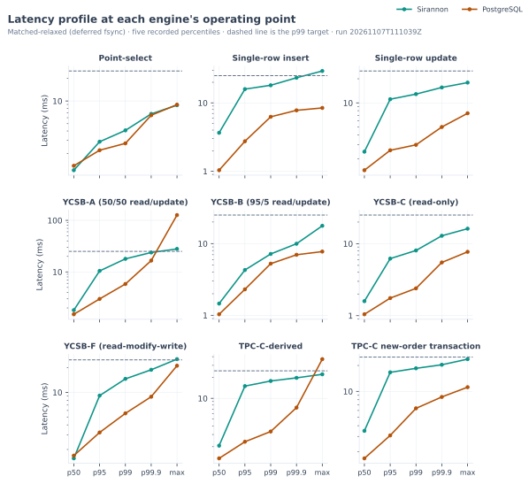
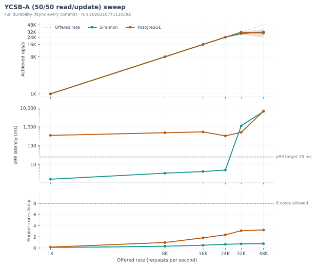
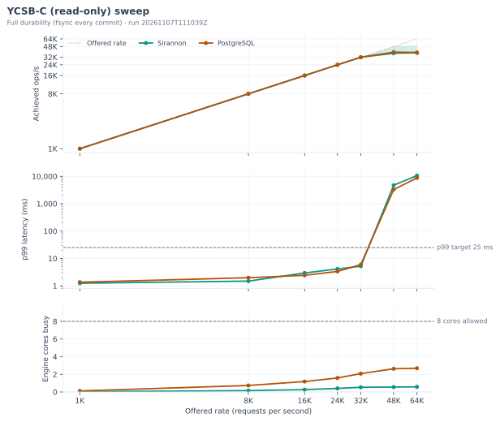
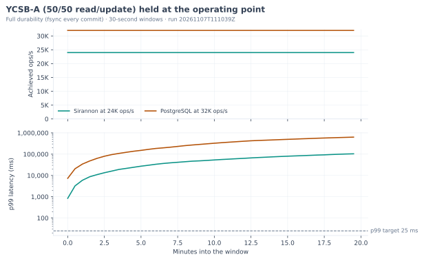
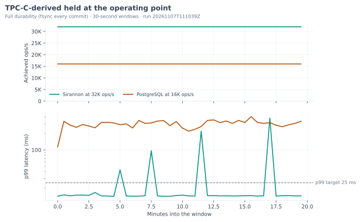
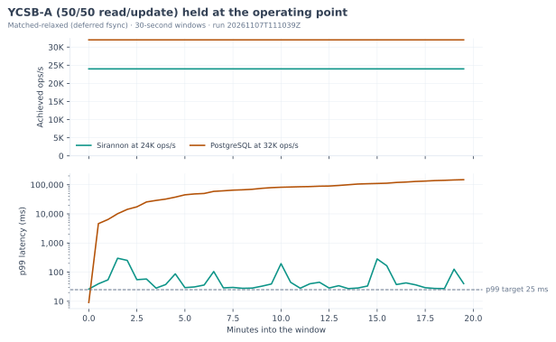
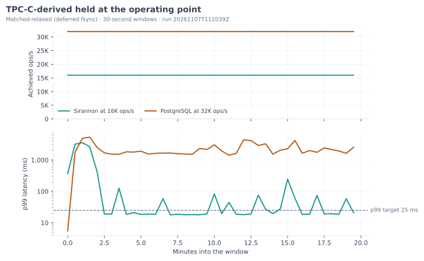

# Sirannon and PostgreSQL over a network

This report gives the results of run `20261107T111039Z` of the Sirannon and PostgreSQL benchmark, which the harness recorded on 2026-11-07. For each workload, it gives the highest rate at which each engine held the latency target, the tail latency at that rate, and the rate at which the engine stopped keeping up. Both engines served the same workloads on one engine machine, while a second machine sent the load, through the client that each engine provides.

## Methodology

One Node load generator drives both databases through a small adapter for each one. Sirannon receives requests from its SDK over the SDK's default WebSocket transport, which sends every concurrent request over one persistent socket, while PostgreSQL receives them from node-postgres over the PostgreSQL wire protocol. The load generator runs on a machine of its own, and both engines answer it over the private network between the two machines. The figures include the cost of the JSON encoding that the Sirannon SDK applies to every call over the WebSocket, because that encoding is part of Sirannon's client path. Before each sweep, the generator measures each client's throughput ceiling against the live engine and records it with the results, so that you can see whether a client limited a rate.

The two engines handle concurrent requests in different ways. PostgreSQL serves each connection with [its own server process](https://www.postgresql.org/docs/18/tutorial-arch.html), which executes one request at a time. PostgreSQL can therefore work on as many requests at once as the pool has connections. While one WAL flush is in progress, PostgreSQL gathers the commits of the other connections that are waiting to flush and writes them all with the next flush, a mechanism that its documentation calls [group commit](https://www.postgresql.org/docs/18/wal-configuration.html). The Sirannon server executes reads one at a time on its main thread, which uses its 4 read connections in turn. For writes, its writer thread commits up to 1,000 queued writes in one transaction, so at full durability one fsync makes the whole group durable.

Both engines operate as native processes under Linux cgroup v2 control. The harness gives the engine under test every logical CPU of the engine machine under a hard memory ceiling, while the load generator has the other machine to itself with no memory cap. The ceiling is smaller than the YCSB table, whose 10,000,000 rows each have ten 100-character fields. Before it seeds any data, the harness checks at the device level that each engine's data directory is on the machine's local NVMe. The harness measures the engines one after the other, starting a fresh engine process for each pass and stopping it afterwards, so neither engine keeps a warm buffer pool from one pass to the next. The harness also removes Sirannon's data directory after each Sirannon pass. Between passes, the harness syncs the disks, waits for dirty pages to drain, trims the data filesystem, and pauses for a fixed interval. Before each pass, it drops the operating system's page cache, so that neither engine starts with pages that the other engine cached.

The harness matches durability at two levels. At full durability, PostgreSQL uses `synchronous_commit=on` and Sirannon uses `synchronous=full`, so both engines fsync every commit. At matched-relaxed, PostgreSQL uses `synchronous_commit=off` and Sirannon uses `synchronous=normal` in WAL mode, so both engines defer the fsync. After a power loss, either engine can then lose its most recent commits, although neither database becomes corrupt.

The load is open-loop, which means that the generator schedules requests at a fixed target rate whether or not earlier requests have returned. When the in-flight limit is full, a scheduled request waits for a free slot. Its latency still counts from the time when the generator was meant to send it, which corrects for coordinated omission. An engine's operating point is the highest offered rate at which the engine sustained the load with the p99 of those latencies at or under the target.

The harness measures every workload at several limits on the number of requests in flight. At each limit, it measures every offered rate once. The limit where the engine's operating point is highest after that first measurement is the engine's peak limit. The harness then measures every rate again at the peak limit until that limit holds the configured number of runs, and the tables report each engine at its peak limit. For PostgreSQL, the driver opens one pooled connection for each request that the limit allows.

Each measured window in the sweep is short, so on selected workloads the harness also holds each engine at its operating point for one long continuous window. That window is long enough to include checkpoints from both engines, so the 30-second slices that the page reports show whether an engine holds its operating point while it checkpoints.

Each engine starts from its defaults. The table below lists every other setting that the harness sets, except addresses and ports, with its default and the reason for its value.

| Engine | Setting | Value | Default | Reason |
| --- | --- | --- | --- | --- |
| PostgreSQL | `shared_buffers` | 512MB | 128MB | The value is 25% of the 2 GB memory ceiling, which the [PostgreSQL documentation](https://www.postgresql.org/docs/18/runtime-config-resource.html#GUC-SHARED-BUFFERS) gives as a starting value for a dedicated server. |
| PostgreSQL | `work_mem` | 64MB | 4MB | The harness raises the memory that PostgreSQL gives each sort and hash operation. Every statement in the benchmark is a key lookup or a single-row write, so none of them sorts or hashes. |
| PostgreSQL | `effective_cache_size` | 1536MB | 4GB | The value is 75% of the 2 GB memory ceiling. The [documentation](https://www.postgresql.org/docs/18/runtime-config-query.html#GUC-EFFECTIVE-CACHE-SIZE) states that the value should cover the shared buffers and the kernel cache for PostgreSQL data, but it gives no figure. |
| PostgreSQL | `maintenance_work_mem` | 256MB | 64MB | [Populating a Database](https://www.postgresql.org/docs/18/populate.html) recommends a larger value while you load large amounts of data. The harness keeps it for the whole pass. |
| PostgreSQL | `wal_level` | minimal | replica | [Populating a Database](https://www.postgresql.org/docs/18/populate.html) recommends it while you load large amounts of data. The harness keeps it for the whole pass, since neither engine replicates in this benchmark. |
| PostgreSQL | `max_wal_senders` | 0 | 10 | PostgreSQL [starts with `wal_level=minimal`](https://www.postgresql.org/docs/18/runtime-config-wal.html#GUC-WAL-LEVEL) only when this setting is 0. |
| PostgreSQL | `checkpoint_timeout` | 15min | 5min | The harness lengthens the interval so that PostgreSQL checkpoints less often. The [documentation](https://www.postgresql.org/docs/18/runtime-config-wal.html#GUC-CHECKPOINT-TIMEOUT) recommends no value, and it warns that a longer interval can lengthen crash recovery. |
| PostgreSQL | `max_wal_size` | 1GB | 1GB | The harness sets the default value explicitly. |
| PostgreSQL | `random_page_cost` | 1.1 | 4.0 | The harness lowers it for the NVMe disk, so that the planner treats a random read as costing about as much as a sequential one. The [documentation](https://www.postgresql.org/docs/18/runtime-config-query.html#GUC-RANDOM-PAGE-COST) suggests a lower value for data that is likely to be completely in cache. |
| PostgreSQL | `max_connections` | 356 | 100 | The pool opens one connection for each request in flight, so the harness adds the highest in-flight limit to the [default](https://www.postgresql.org/docs/18/runtime-config-connection.html#GUC-MAX-CONNECTIONS). |
| PostgreSQL | `statement_timeout` | 60000 ms | 0, which turns it off | The PostgreSQL driver sets it to the load generator's request timeout. |
| Sirannon | `writerWorker` | on | off | The [server guide](https://github.com/assetcorp/sirannon-db/blob/main/docs/server.md#writer-worker) recommends it so that a disk flush leaves the serving thread free. |
| Sirannon | `writerWorker.writeTimeoutMs` | 0, which turns it off | 30000 ms | In an earlier benchmark, Sirannon reported the writer unresponsive 30 seconds into a `DROP TABLE` between workloads, because inside the 2 GB memory ceiling that drop can take more than a minute. |
| Sirannon | `maxBodyBytes` | 1 GiB | 1 MiB | The seed load sends 25,000 rows in each request, and a request of that size exceeds 1 MiB. |
| Sirannon | `readPoolSize` | 4 | 4 | The harness sets the default value explicitly. |
| Sirannon | `walMode` | true | true | The harness sets the default value explicitly. |

## Run and machine

- **Run.** [The run report](benchmarks/server/results/runs/20261107T111039Z/comparison.md) gives the full results of run `20261107T111039Z`, which the harness recorded on 2026-11-07. For every pass, the harness recorded commit `fe1824644af9`.
- **Machine.** The engine machine was GCP c3-standard-8-lssd, us-central1-a, where the harness recorded 8 logical CPUs (Intel(R) Xeon(R) Platinum 8481C CPU @ 2.70GHz), 31.3 GB of memory, and Ubuntu 24.04.5 LTS on x86_64. The load generator ran on GCP c3-standard-8, us-central1-a, where the harness recorded 8 logical CPUs (Intel(R) Xeon(R) Platinum 8481C CPU @ 2.70GHz), 31.3 GB of memory, and Linux 7.0.0-1017-gcp on x64. Before each pass, the load generator opened 200 TCP connections to the engine machine, and each connection took a median of 0.091 ms to open, with a p99 of 2.000 ms.
- **Engines.** The harness measured Sirannon 0.4.0, whose storage engine is SQLite 3.53.4, and PostgreSQL 18.6 at full durability (fsync every commit) and at matched-relaxed (deferred fsync). Each engine operated as a native process under a 2G memory ceiling that cgroup v2 enforces, with logical CPUs 0-7 of the engine machine to itself.
- **Delivery.** One Node load generator on the load machine sent every request over the private network, through the client that each engine provides. The Sirannon SDK sent its requests to Sirannon over one WebSocket, while node-postgres opened one pooled connection to PostgreSQL for each request in flight. The harness measured every workload with at most 16, 64, and 256 requests in flight. The tables report each engine at its peak limit, which is the limit where its operating point was highest after one measurement at each rate.
- **Load-client headroom.** With 16, 64, and 256 requests in flight, the Sirannon SDK alone sustained 102.9K, 121.5K, and 138.7K requests a second against its live engine. At the same limits, node-postgres sustained 66.4K, 64.4K, and 60.5K requests a second. Each client's ceiling is above every operating point that its engine reached, so neither client limited a reported operating point.
- **Workloads.** Of the 9 workloads, 8 start from a table that the harness seeds with 10,000,000 rows. For the Single-row insert workload, the table starts empty, so every row in it comes from the inserts that the generator sends during the sweep, with keys between 1 and 10,000,000. The harness offers target rates of 1,000, 8,000, 16,000, 24,000, 32,000, 48,000, and 64,000 requests a second. It raises each engine's rate along that list until the engine fails to sustain one. After that failure, it measures one more rate and stops, so the two sweeps can end at different rates. Each measurement has a 3 s warmup and a 10 s window under seed `42`. At each in-flight limit, the harness measures every rate once. It then measures every rate 4 more times at the engine's peak limit, so each figure that the tables report at that limit is the median of those 5 repetitions with a 95% confidence interval. The service-level target for an operating point is a p99 of at most 25 ms. At the engine's peak in-flight limit, when the next rate on the list of target rates is more than twice the highest rate at which the engine met the service-level target, the harness also searches the gap between the two. It halves that gap 3 times and measures each searched rate as many times as each listed rate, so the operating point can be a searched rate.
- **Soak.** After the sweep, the harness held each engine at its operating point, with the in-flight limit at which it reached that point, on YCSB-A (50/50 read/update) and TPC-C-derived for one continuous 20-minute window, which the page reports in 30-second slices.
- **Timeouts.** Sirannon's writer deadline was off, although its default is 30 seconds. The PostgreSQL driver set `statement_timeout` to the load generator's request timeout of 60,000 ms, which PostgreSQL reported as `1min`, while the PostgreSQL default of 0 turns that timeout off. No request failed at any rate in either engine's sweep, so neither limit ended a request. The Sirannon driver gave each schema reset between workloads a 30-minute request limit.

## Operating points

### Full durability (fsync every commit)

| Workload | Sirannon ops/s | Sirannon 95% CI | Sirannon CV | Sirannon p99 ms | Sirannon missed at | Postgres ops/s | Postgres p99 ms | Postgres missed at | Rate ratio |
| --- | ---: | ---: | ---: | ---: | ---: | ---: | ---: | ---: | ---: |
| Point-select | **64.0K** | [64.0K, 64.1K] | 0.1% | 6.463 | held every rate | 48.0K | 6.213 | 64.0K (4,325 ms) | 1.33x [1.33x, 1.34x] |
| Single-row insert | 32.0K | [32.0K, 32.1K] | 0.1% | 19.000 | 48.0K (5,028 ms) | 32.0K | 14.566 | 48.0K (1,235 ms) | 1.00x [1.00x, 1.00x] |
| Single-row update | **48.0K** | [48.0K, 48.0K] | 0.0% | 9.626 | 64.0K (379 ms) | 24.0K | 4.686 | 32.0K (87.317 ms) | 2.00x [2.00x, 2.00x] |
| YCSB-A (50/50 read/update) † | **24.0K** | [24.0K, 24.0K] | 0.0% | 5.096 | 32.0K (1,136 ms) | 31.8K | 511 | 48.0K (6,866 ms) | n/a |
| YCSB-B (95/5 read/update) | 32.0K | [27.7K, 32.0K] | 6.1% | 4.970 | 48.0K (6,327 ms) | 32.0K | 6.972 | 48.0K (3,295 ms) | 0.97x [0.92x, 1.00x] |
| YCSB-C (read-only) | 32.0K | [32.0K, 32.0K] | 0.0% | 5.204 | 48.0K (4,709 ms) | 32.0K | 5.945 | 48.0K (3,266 ms) | 1.00x [1.00x, 1.00x] |
| YCSB-F (read-modify-write) | 24.0K | [22.1K, 24.0K] | 3.6% | 7.704 | 32.0K (2,877 ms) | 24.0K | 7.357 | 32.0K (1,766 ms) | 0.97x [0.94x, 1.00x] |
| TPC-C-derived | **32.0K** | [32.0K, 32.0K] | 0.1% | 14.282 | 48.0K (117 ms) | 16.0K | 4.517 | 24.0K (42.516 ms) | 2.00x [2.00x, 2.00x] |
| TPC-C new-order transaction | **16.0K** | [16.0K, 16.0K] | 0.1% | 16.984 | 24.0K (2,204 ms) | 6.3K ‡ | 15.996 | 7.1K ‡ (42.579 ms) | 2.56x [2.56x, 2.56x] |

_A † marks a workload where an engine's p99 exceeded the target at every offered rate. For that engine, the table gives the highest rate that it sustained, which is not an operating point. The table therefore gives that workload no rate ratio, while the bold marks only an engine that held the target._

### Matched-relaxed (deferred fsync)

| Workload | Sirannon ops/s | Sirannon 95% CI | Sirannon CV | Sirannon p99 ms | Sirannon missed at | Postgres ops/s | Postgres p99 ms | Postgres missed at | Rate ratio |
| --- | ---: | ---: | ---: | ---: | ---: | ---: | ---: | ---: | ---: |
| Point-select | **64.0K** | [64.0K, 64.0K] | 0.0% | 4.072 | held every rate | 32.0K | 2.739 | 48.0K (1,295 ms) | 2.00x [2.00x, 2.00x] |
| Single-row insert | 24.0K | [24.0K, 24.0K] | 0.1% | 18.093 | 32.0K (146 ms) | **48.0K** | 6.262 | 64.0K (2,082 ms) | 0.50x [0.50x, 0.51x] |
| Single-row update | 48.0K | [48.0K, 48.0K] | 0.0% | 12.877 | 64.0K (236 ms) | 48.0K | 2.999 | 64.0K (1,215 ms) | 1.00x [1.00x, 1.00x] |
| YCSB-A (50/50 read/update) | 24.0K | [24.0K, 24.0K] | 0.0% | 17.928 | 32.0K (837 ms) | **32.0K** | 5.830 | 48.0K (1,902 ms) | 0.77x [0.75x, 0.82x] |
| YCSB-B (95/5 read/update) | **48.0K** | [35.4K, 48.0K] | 15.9% | 7.172 | held every rate | 32.0K | 5.249 | 48.0K (3,348 ms) | 1.35x [1.19x, 1.50x] |
| YCSB-C (read-only) | **48.0K** | [48.0K, 48.0K] | 0.0% | 8.052 | 64.0K (2,642 ms) | 32.0K | 2.396 | 48.0K (2,943 ms) | 1.50x [1.50x, 1.50x] |
| YCSB-F (read-modify-write) | **32.0K** | [26.9K, 32.0K] | 7.2% | 14.637 | 48.0K (5,423 ms) | 24.0K | 5.534 | 32.0K (1,915 ms) | 1.28x [1.19x, 1.33x] |
| TPC-C-derived | 16.0K | [16.0K, 16.0K] | 0.0% | 17.817 | 24.0K (1,848 ms) | **32.0K** | 3.316 | 48.0K (1,199 ms) | 0.50x [0.50x, 0.50x] |
| TPC-C new-order transaction | **16.0K** | [16.0K, 16.0K] | 0.1% | 18.522 | 24.0K (1,355 ms) | 7.1K ‡ | 6.359 | 8.0K (300 ms) | 2.25x [2.25x, 2.25x] |

_Bold marks the higher of the two operating points on each workload, counting only the engines that held the target. Where both engines held the target at the same rate, neither cell is bold. Each p99 comes from its own engine's operating point, so the two p99 columns can describe different offered rates. For both engines at one offered rate, use the sweep tables below. Each 'missed at' column gives the next offered rate above the operating point at which that engine missed the target, with its p99 at that rate._

_Each throughput figure is the median of the repeated measurements at the operating point, which is the highest offered rate that the engine held at or under the p99 target. The table shows each Sirannon figure with a 95% bootstrap confidence interval and the coefficient of variation across repetitions. The rate ratio is Sirannon's operating point divided by PostgreSQL's, so a ratio above one means that Sirannon held the target at a higher rate. Every ratio is approximate, because the harness measures only the listed target rates and the rates that it searched between them, so an engine's highest sustainable rate lies between its operating point and the rate in its 'missed at' column. For TPC-C-derived, the generator sends two kinds of one-statement write in equal shares, which are an insert into `orders` and an update of one customer's balance. Neither write is a full TPC-C transaction. The harness measures YCSB A, B, C, and F, but not D or E._

_A ‡ marks a rate that is not on the list of target rates. The harness found it by halving a wide gap in that list at the engine's peak in-flight limit, and it measured that rate as many times as each listed rate._

_For the TPC-C new-order transaction, every operation is one transaction of six statements, which insert an order, take stock from four products in ascending product order, and charge the customer's balance. Taking the rows in one order means that two transactions never lock the same products in opposite orders, which is how the PostgreSQL manual says to avoid deadlocks._

_Each client decides how many network round trips one operation takes. The Sirannon SDK sends a transaction as one request, while node-postgres sends `BEGIN`, every statement, and `COMMIT` as separate round trips. The table gives the weighted mean for each workload's mix of operations._

| Workload | Statements per operation | Sirannon round trips | PostgreSQL round trips |
| --- | ---: | ---: | ---: |
| Point-select | 1 | 1 | 1 |
| Single-row insert | 1 | 1 | 1 |
| Single-row update | 1 | 1 | 1 |
| YCSB-A (50/50 read/update) | 1 | 1 | 1 |
| YCSB-B (95/5 read/update) | 1 | 1 | 1 |
| YCSB-C (read-only) | 1 | 1 | 1 |
| YCSB-F (read-modify-write) | 1.50 | 1.50 | 1.50 |
| TPC-C-derived | 1 | 1 | 1 |
| TPC-C new-order transaction | 6 | 1 | 8 |

### Operating points at each in-flight limit

_Each cell gives the operating point that an engine reached with at most that many requests in flight, with its p99 in brackets. An engine's peak limit is the one where its operating point was highest after one measurement at each rate. The harness measured every rate again at that limit, so the cell at the peak limit rests on every repetition, while the engine's other cells rest on one measurement. A † marks a cell where the engine's p99 exceeded the target at every offered rate._

#### Full durability (fsync every commit)

| Workload | Engine | 16 in flight | 64 in flight | 256 in flight | Peak limit |
| --- | --- | ---: | ---: | ---: | ---: |
| Point-select | Sirannon | 64.0K (5.432 ms) | 64.0K (4.901 ms) | 64.0K (6.463 ms) | 256 |
| Point-select | PostgreSQL | 48.0K (6.213 ms) | 32.0K (3.017 ms) | 32.0K (2.819 ms) | 16 |
| Single-row insert | Sirannon | 8.0K (9.520 ms) | 24.0K (14.928 ms) | 32.0K (19.000 ms) | 256 |
| Single-row insert | PostgreSQL | 16.0K (20.888 ms) | 32.0K (14.566 ms) | 32.0K (5.304 ms) | 64 |
| Single-row update | Sirannon | 8.0K (8.156 ms) | 32.0K (8.130 ms) | 48.0K (9.626 ms) | 256 |
| Single-row update | PostgreSQL | 8.0K (4.771 ms) | 24.0K (4.686 ms) | 24.0K (7.726 ms) | 64 |
| YCSB-A (50/50 read/update) | Sirannon | 8.0K (9.251 ms) | 24.0K (5.096 ms) | 24.0K (5.343 ms) | 64 |
| YCSB-A (50/50 read/update) | PostgreSQL | 32.0K (511 ms) † | 32.0K (463 ms) † | 24.0K (262 ms) † | 16 |
| YCSB-B (95/5 read/update) | Sirannon | 1.0K (1.849 ms) | 32.0K (4.970 ms) | 16.0K (3.037 ms) | 64 |
| YCSB-B (95/5 read/update) | PostgreSQL | 1.0K (1.920 ms) | 32.0K (6.972 ms) | 1.0K (1.749 ms) | 64 |
| YCSB-C (read-only) | Sirannon | 8.0K (4.916 ms) | 24.0K (3.905 ms) | 32.0K (5.204 ms) | 256 |
| YCSB-C (read-only) | PostgreSQL | 32.0K (5.945 ms) | 24.0K (4.186 ms) | 8.0K (2.267 ms) | 16 |
| YCSB-F (read-modify-write) | Sirannon | 1.0K (2.422 ms) | 16.0K (5.398 ms) | 24.0K (7.704 ms) | 256 |
| YCSB-F (read-modify-write) | PostgreSQL | 16.0K (460 ms) † | 24.0K (7.357 ms) | 24.0K (299 ms) † | 64 |
| TPC-C-derived | Sirannon | 8.0K (9.182 ms) | 24.0K (11.892 ms) | 32.0K (14.282 ms) | 256 |
| TPC-C-derived | PostgreSQL | 8.0K (6.188 ms) | 16.0K (4.517 ms) | 16.0K (4.437 ms) | 64 |
| TPC-C new-order transaction | Sirannon | 8.0K (8.329 ms) | 8.0K (8.430 ms) | 16.0K (16.984 ms) | 256 |
| TPC-C new-order transaction | PostgreSQL | 6.2K ‡ (15.996 ms) | 8.0K (377 ms) † | 1.0K (15.377 ms) | 16 |

#### Matched-relaxed (deferred fsync)

| Workload | Engine | 16 in flight | 64 in flight | 256 in flight | Peak limit |
| --- | --- | ---: | ---: | ---: | ---: |
| Point-select | Sirannon | 64.0K (5.646 ms) | 64.0K (4.072 ms) | 64.0K (6.418 ms) | 64 |
| Point-select | PostgreSQL | 24.0K (2.133 ms) | 32.0K (2.951 ms) | 32.0K (2.739 ms) | 256 |
| Single-row insert | Sirannon | 16.0K (15.598 ms) | 24.0K (18.093 ms) | 24.0K (18.485 ms) | 64 |
| Single-row insert | PostgreSQL | 48.0K (6.262 ms) | 48.0K (7.364 ms) | 32.0K (3.202 ms) | 16 |
| Single-row update | Sirannon | 32.0K (11.240 ms) | 48.0K (10.976 ms) | 48.0K (12.877 ms) | 256 |
| Single-row update | PostgreSQL | 8.0K (1.841 ms) | 48.0K (2.999 ms) | 48.0K (5.400 ms) | 64 |
| YCSB-A (50/50 read/update) | Sirannon | 8.0K (12.326 ms) | 16.0K (9.093 ms) | 24.0K (17.928 ms) | 256 |
| YCSB-A (50/50 read/update) | PostgreSQL | 16.0K (2.720 ms) | 16.0K (21.402 ms) | 32.0K (5.830 ms) | 256 |
| YCSB-B (95/5 read/update) | Sirannon | 1.0K (2.046 ms) | 48.0K (7.172 ms) | 16.0K (3.091 ms) | 64 |
| YCSB-B (95/5 read/update) | PostgreSQL | 32.0K (5.249 ms) | 8.0K (1.966 ms) | 8.0K (2.626 ms) | 16 |
| YCSB-C (read-only) | Sirannon | 1.0K (1.904 ms) | 24.0K (4.209 ms) | 48.0K (8.052 ms) | 256 |
| YCSB-C (read-only) | PostgreSQL | 32.0K (2.396 ms) | 24.0K (8.323 ms) | 8.0K (2.290 ms) | 16 |
| YCSB-F (read-modify-write) | Sirannon | 1.0K (2.197 ms) | 8.0K (16.789 ms) | 32.0K (14.637 ms) | 256 |
| YCSB-F (read-modify-write) | PostgreSQL | 1.0K (1.960 ms) | 24.0K (5.534 ms) | 8.0K (9.668 ms) | 64 |
| TPC-C-derived | Sirannon | 16.0K (19.749 ms) | 16.0K (17.817 ms) | 8.0K (16.649 ms) | 64 |
| TPC-C-derived | PostgreSQL | 16.0K (3.019 ms) | 32.0K (20.980 ms) | 32.0K (3.316 ms) | 256 |
| TPC-C new-order transaction | Sirannon | 8.0K (12.880 ms) | 16.0K (14.080 ms) | 16.0K (18.522 ms) | 256 |
| TPC-C new-order transaction | PostgreSQL | 7.1K ‡ (6.359 ms) | 1.0K (2.089 ms) | 1.0K (2.251 ms) | 16 |

_A ‡ marks a rate that is not on the list of target rates. The harness found it by halving a wide gap in that list at the engine's peak in-flight limit, and it measured that rate as many times as each listed rate._

## Throughput versus offered load

Each figure and table below shows one workload at full durability (fsync every commit), at every offered rate in the sweep. PostgreSQL locks individual rows, while Sirannon commits every write through a single writer, so which engine keeps up as the rate rises depends on the workload. The dotted line on the top panel marks the offered rate, so the point where an engine's curve falls below that line is the rate at which the engine stopped keeping up.

_Each row gives both engines at the same offered rate, so bold marks the better of the two figures, which is the higher achieved throughput and the lower p99. Where the two figures are equal, neither is bold._

### YCSB-A (50/50 read/update)

| Target ops/s | Sirannon ops/s | Sirannon p99 ms | Postgres ops/s | Postgres p99 ms |
| ---: | ---: | ---: | ---: | ---: |
| 1,000 | **1.0K** | **1.656** | 1000 | 353 |
| 8,000 | 8.0K | **3.467** | 8.0K | 486 |
| 16,000 | 16.0K | **4.239** | 16.0K | 539 |
| 24,000 | 24.0K | **5.096** | 24.0K | 332 |
| 32,000 | 29.3K | 1,136 | **31.8K** | **511** |
| 48,000 | **32.1K** | **6,622** | 30.2K | 6,866 |

### YCSB-C (read-only)

| Target ops/s | Sirannon ops/s | Sirannon p99 ms | Postgres ops/s | Postgres p99 ms |
| ---: | ---: | ---: | ---: | ---: |
| 1,000 | 1.0K | **1.242** | 1.0K | 1.356 |
| 8,000 | 8.0K | **1.485** | 8.0K | 1.974 |
| 16,000 | 16.0K | 2.950 | 16.0K | **2.420** |
| 24,000 | 24.0K | 4.125 | 24.0K | **3.354** |
| 32,000 | 32.0K | **5.204** | 32.0K | 5.945 |
| 48,000 | 37.2K | 4,709 | **38.8K** | **3,266** |
| 64,000 | 37.7K | 10,625 | **38.2K** | **8,745** |

_The directory `charts/` contains the same three-panel figure for every workload at both durability levels._

## Holding the operating point

Each sweep window is short, so for this section the harness held each engine at its operating point for one long continuous window. That window is long enough to include checkpoints from both engines, so the 'Worst 30 s p99' column, which gives the slowest 30-second slice, shows any stall that a checkpoint causes. Each figure plots every 30-second slice in order, so a periodic stall appears as a spike and a steady slowdown appears as a raised floor. An engine holds its operating point when it keeps at least 95% of the rate across the whole window, with under 1% errors and a p99 at or under the service-level target. An engine that keeps the rate with a p99 above the target therefore counts as a miss. Bold marks the higher achieved rate of the two engines on each workload. Where one engine held and the other missed, bold also marks the engine that held. Since each engine served its own operating point during the window, neither latency column is bold.

### Full durability (fsync every commit)

| Workload | Engine | Rate held | Achieved | p99 ms | Worst 30 s p99 | Errors | Held |
| --- | --- | ---: | ---: | ---: | ---: | ---: | --- |
| YCSB-A (50/50 read/update) | Sirannon | 24,000 | **22.1K** | 102,981 | 103,785 | 0.0% | no |
| YCSB-A (50/50 read/update) | PostgreSQL | 32,000 | 20.7K | 624,235 | 630,819 | 0.0% | no |
| TPC-C-derived | Sirannon | 32,000 | **32.0K** | 14.767 | 385 | 0.0% | **yes** |
| TPC-C-derived | PostgreSQL | 16,000 | 16.0K | 303 | 408 | 0.0% | no |

### Matched-relaxed (deferred fsync)

| Workload | Engine | Rate held | Achieved | p99 ms | Worst 30 s p99 | Errors | Held |
| --- | --- | ---: | ---: | ---: | ---: | ---: | --- |
| YCSB-A (50/50 read/update) | Sirannon | 24,000 | 24.0K | 225 | 300 | 0.0% | no |
| YCSB-A (50/50 read/update) | PostgreSQL | 32,000 | **28.5K** | 147,099 | 148,928 | 0.0% | no |
| TPC-C-derived | Sirannon | 16,000 | 16.0K | 3,402 | 3,552 | 0.0% | no |
| TPC-C-derived | PostgreSQL | 32,000 | **31.9K** | 3,991 | 5,336 | 0.0% | no |

## Cold start and change-feed latency

### Cold start

Cold start is the time from the command that starts the engine process to the first successful health probe, which the harness measures in the same way for both engines. Bold marks the faster start.

| Engine | Cold start ms |
| --- | ---: |
| Sirannon | 203 |
| PostgreSQL | **86.000** |

### Change-feed latency (Sirannon only)

This table gives the delay between the client sending a write and a subscriber receiving the change over Sirannon's built-in WebSocket feed. The server polls the change log every 50 ms. The harness sends each probe write as soon as the subscriber receives the previous change, so each write commits shortly after a poll and its change waits close to one full interval for the next poll. The harness measures no PostgreSQL equivalent, so the table gives Sirannon's figures alone.

| Samples | p50 ms | p95 ms | p99 ms | max ms |
| ---: | ---: | ---: | ---: | ---: |
| 200 | 50.407 | 51.414 | 51.500 | 51.547 |
